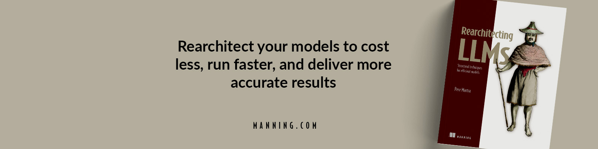

# Rearchitecting LLMs. 
**Structural techniques for efficient models**

[](https://github.com/peremartra/Rearchitecting-LLMs/stargazers)
[](https://opensource.org/licenses/Apache-2.0)
[](https://www.python.org/downloads/)


Rearchitecting LLMs addresses the growing need for AI professionals who understand how LLMs work at a fundamental level—professionals who can create hyper-efficient models tailored to specific data and tasks rather than relying on one-size-fits-all solutions.

---

<a href="https://hubs.la/Q040tvsK0">
  
</a>

*This is the official repository for the book [Rearchitecting LLMs - Structural techniques for efficient models](	
https://hubs.la/Q040tvsK0). Although the notebooks include explanations so they can be understood and run individually, the best experience is through the book, which provides more details on the experiments, decisions, papers, and technologies used.*

The industry is shifting away from generic, closed-source models toward open-source alternatives that offer better stability, data privacy, lower operational costs, and competitive differentiation that proprietary APIs cannot provide. However, this transition faces a critical bottleneck: a shortage of engineers equipped with the deep architectural knowledge required to optimize these models effectively.

The book teaches **optimization techniques** for transforming large pre-trained models into efficient Small Language Models (SLMs). These methodologies—including depth pruning, width pruning in GLU architectures, and knowledge distillation—are similar to approaches used by companies like [**Nvidia**](https://arxiv.org/abs/2407.14679) (Minitron family) and [**Mistral**](https://arxiv.org/abs/2601.08584) (Ministral family) to create production-ready model families.

Beyond these foundational techniques, the book introduces **original methodologies** like Fair Pruning (bias-aware optimization), combining industry best practices with cutting-edge research. You'll learn to apply all these techniques to open-source models like Llama, Gemma, and Qwen, with hands-on notebooks that most of them run on a free Colab; those that need a more powerful GPU say so in the chapter’s README.

* Surgically optimize model architectures through depth and width pruning
* Recover lost knowledge using targeted distillation techniques
* Specialize models for your specific domain and use case
* Measure and validate every optimization decision 


*The Rearchitecting Pipeline. The domain-specific dataset guides the calibration of the base model, informs structural optimization decisions, and drives the final specialization through LoRA fine-tuning. A general dataset supports Knowledge Recovery, ensuring the pruned model retains broad capabilities before domain-specific specialization. This dual approach optimizes each phase for the project's specific objectives.*

## 📚 Book Contents

| | Chapter | What you'll learn |
|---|---|---|
| **PART 1: FOUNDATIONS** | | |
| ✅ | 1 · Why rearchitecting LLMs matters | The case for specialized models over generic LLMs |
| ✅ | [2 · An end-to-end rearchitecting project](CH02/) | Full pipeline: prune and recover |
| ✅ | [3 · A blueprint to modern transformers](CH03/) | GLU architectures, attention, and model internals |
| **PART 2: HANDS-ON OPTIMIZATION** | | |
| ✅ | [4 · Building smaller and faster LLMs with depth pruning](CH04/) | Block removal, caputure block importance with python hooks, evaluate pruning |
| ✅ | [5 · Shaping model architectures via width pruning](CH05/) | GLU neuron selection, data-driven pruning strategies |
| ✅ | [6 · Knowledge recovery through distillation](CH06/) | Recovering capability after structural compression |
| ✅ | [7 · Model specialization](CH07/) | LoRA / DoRA fine-tuning and quantization for domain tasks |
| ✅ | [8 · Attention Optimization](CH08/) | KV cache, attention bypass, inference acceleration |
| ✅ | [9 · Dynamic routing with Mixture of Experts](CH09) | Mixture of Experts (MoE) adapted to SLMs.  |
| **PART 3: BEYOND THE BLACK BOX** | | |
| ✅ | [10 · Exploring the Trasformer Black Box](CH10) | Activation analysis and behavioral interpretability |
| ✅ | [11 · Precision pruning for bias](CH11) | Fair pruning: removing demographic bias at neuron level |
| ✅ | [12 · Case study — Replacing one agent call with a specialized SLM in production](CH12) by [Ishita Verma](https://www.linkedin.com/in/ishitaverma17)| Replacing API calls with a specialized SLM |
| ✅ | [13 · Capstone II — Creating a model family for agents](CH13)  | Create 3 different models from a base one |

## 🧠 Your Interactive Technical Companion: NotebookLM Space

[](https://notebooklm.google.com/notebook/a059766a-14bf-4d75-8840-b05a79be680e)

**Start experimenting interactively.**

This NotebookLM space contains all the research papers, chapter notebooks, and optiPfair guides in a conversational format. Think of it as your AI-powered technical assistant for the book, which helps you to become an LLM architect. 

**What you can do:**
- **Ask specific questions**: "How does depth pruning work?" or "How many layers can I remove from a 70B model?"
- **Get code snippets**: "Show me the code to reduce the GLU expansion of Llama3"
- **Explore techniques**: Query any pruning, distillation, or optimization method
- **Troubleshoot**: Get help understanding implementation details from the notebooks

Perfect for:
- Quick reference while coding
- Understanding paper implementations
- Exploring techniques before diving into chapters
- Clarifying concepts on the go

**[→ Launch NotebookLM Space](https://notebooklm.google.com/notebook/a059766a-14bf-4d75-8840-b05a79be680e)**

> 💡 **Pro tip**: Use NotebookLM for quick queries and experimentation. For structured, in-depth learning, the book remains your best companion.

Stop being a mere user. It's time to become an architect.

## 🧪 Join the Hands-on Labs Discussions

Every chapter in this book includes a specific Hands-on Lab designed to push your understanding of model architecture. We use GitHub Discussions as our active laboratory to share metrics, architectural insights, doubts, and even Out-of-Memory (OOM) errors.

## 🎓 Using this book in a course

Teaching with *Rearchitecting LLMs*? A class, a study group or a company reading group can run the hands-on labs together using a fork of this repository.

1. **Fork once per cohort.** The instructor forks this repo and enables *Settings → General → Features → Discussions* in the fork. Notebooks keep opening from this repository through the Colab badges, so students always run the latest version.
2. **Seed the discussions.** In the fork's *Actions* tab, enable workflows and run **Seed cohort discussions** ([direct link](../../actions/workflows/seed_discussions.yml)). It copies the *Hands-on Discussion* of every chapter from CH02 to CH13 (Chapter 1 has none), with the same labels (`CH06`, `hands-on labs`), so you can filter the fork's discussions exactly as in the link above. It is safe to run more than once.
3. **Students answer inside the thread.** Each student posts one comment following the results template at the end of the discussion (exercise attempted, model, hardware and versions, configurations tried, results, match with the chapter, key insight, link). Numbers that don't match the chapter are as useful as those that do, and failed runs and OOM errors count. Replies are for peer review.
4. **Hardware.** Most labs run on a free Colab T4. Those needing an L4 or A100 say so in the chapter README, and the Chapter 6 challenge can be explored by changing configuration even without an A100. Students with an Apple Silicon Mac can also run most labs locally: see [Running the notebooks on a Mac](#-running-the-notebooks-on-a-mac-apple-silicon).

**Good to know**
- Enabling Actions in the fork also enables this repository's notebook-cleanup workflow, which amends and force-pushes any push that touches `.ipynb` files. Don't push notebooks to `main`; share them as Colab links or Gists. Once the discussions are seeded, you can disable Actions again in the fork's settings.
- A fork of a public repo is public, so submissions are visible to everyone. Tell students before they post.
- Use *Sync fork* to pick up new notebooks and fixes.
- The repo is Apache-2.0: keep the LICENSE and cite the book (see below).

**Running a course with this book?** I'd like to hear about it: open a Discussion in the *Courses* category.

**[→ Explore all Hands-on Labs Discussions](https://github.com/peremartra/Rearchitecting-LLMs/discussions?discussions_q=is%3Aopen+label%3A%22hands-on+labs%22)**

## 🍏 Running the notebooks on a Mac (Apple Silicon)

The notebooks are written for Colab GPUs, but they also run locally on Apple Silicon Macs (M1 or newer) through PyTorch's Metal backend (MPS). Every notebook picks its device in the same order: CUDA if available, then Apple Silicon (MPS), then CPU. `utils.py` follows the same rule, and you can force a device by setting `OPTIPFAIR_DEVICE=cpu|mps|cuda` (the same variable used by the [optipfair](https://github.com/peremartra/optipfair) library).

**Setup**

```bash
git clone https://github.com/peremartra/Rearchitecting-LLMs.git
cd Rearchitecting-LLMs
python3 -m venv .venv && source .venv/bin/activate
pip install torch transformers accelerate datasets lm-eval optipfair peft trl \
    langdetect codecarbon matplotlib seaborn pandas scikit-learn jupyter
brew install wget            # notebooks download utils.py with !wget
jupyter lab
```

Most notebooks pin the versions the book was tested with in their first cell; run it if you want exactly those versions. Llama and Gemma models, and the `Salesforce/xlam-function-calling-60k` dataset used in Chapter 13, are gated on Hugging Face: accept their licences and run `hf auth login` once.

**What to expect**

- macOS 14 (Sonoma) or newer is required for `bfloat16` on MPS.
- GPU memory is the Mac's unified memory, shared with macOS and your other apps. In `bfloat16` the weights alone take about 2 GB per billion parameters (Qwen3-0.6B ≈ 1.2 GB, SmolLM2-1.7B ≈ 3.4 GB, Llama-3.2-3B ≈ 6.4 GB, Llama-3.1-8B ≈ 16 GB), and distillation notebooks keep a teacher and a student in memory at the same time.
- Latency, throughput and energy numbers (CH04, CH05, CH08, Appendices C and D) will not match the T4/L4 figures in the book; compare models against each other on the same machine. CodeCarbon (energy) reads real power only when it can run `sudo powermetrics` without a password prompt; otherwise it falls back to an estimate based on the CPU's rated power.
- `bitsandbytes` 4-bit quantization (CH03, CH07, CH08) works on MPS with the versions the notebooks pin (0.49.2) and newer.

**Status on Apple Silicon**

Tested on an M2 Max (macOS 26.4, PyTorch 2.15). Training runs were shortened (1 epoch, `lm-eval` limited to 20 examples per task) to check that every cell runs, not to reproduce the book's numbers.

| Chapter | Status on a Mac | Notes |
|---|---|---|
| 2, 3, 5, 10, 11 | Ported, not yet tested | Use gated Llama or Gemma models |
| 4 | Tested: `CH04_NB01_Cosine_Similarity` | Layer importance, depth pruning, recovery, benchmarks and timing (~16 min) |
| 6 | Tested: `CH06_NB02_Width_Pruned_Model_Recovery` | Width pruning and distillation with all four loss terms (~8 min) |
| 7 | Tested: `CH07_NB02_L4_QLoRA_QDoRA` | 4-bit QLoRA and QDoRA training both work; evaluating the QDoRA adapter is slow (more than 40 min) |
| 8 | NB01: 4-bit KV cache checked with Qwen3-0.6B. **NB02: NVIDIA only** (vLLM) | NB03/NB04 use Llama-3.2-3B / 3.1-8B (gated; 8B needs 32 GB+) |
| 9 | Tested: `CH09_NB01_MoE` | fp16 mixed-precision router and expert training (~23 min) |
| 12 | **NB01: NVIDIA only** (vLLM). NB02 is pure Python | |
| 13 | Ported, not yet tested | Gated `Salesforce/xlam-function-calling-60k` dataset |
| Appendix B, C | Ported, not yet tested | Use gated `google/gemma-3-270m` |
| Appendix D | Tested: `APPD_NB01_examples` | ~10 min. On a Mac, run-to-run variation at long prompts can be large; the notebook's noise-floor check shows when a difference is real |

"Ported, not yet tested" notebooks use the same device changes as the tested ones. Reports from Mac users are welcome in the Discussions.

## 🌟 Support This Project

If you find these techniques useful, consider:
- ⭐ Starring this repo to stay updated
- 🔄 Sharing it with your team
- 💬 Opening Discussions with your questions


## Citation

If you find this repository or the techniques described in the book useful, please cite it as follows:

**APA:**
Martra, P. (2026). *Rearchitecting LLMs: Structural techniques for efficient models*. Manning Publications. ISBN 9781633434332.

**BibTeX:**
```bibtex
@book{martra2026rearchitecting,
  title={Rearchitecting LLMs: Structural techniques for efficient models},
  author={Martra, Pere},
  isbn={9781633434332},
  year={2026},
  publisher={Manning Publications},
  url={[https://www.manning.com/books/rearchitecting-llms](https://www.manning.com/books/rearchitecting-llms)},
  note={Manning Early Access Program (MEAP)}
}
